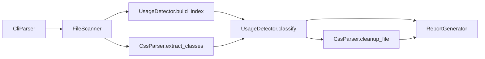

# Architecture

CSS Checker is a single C++17 executable. There is no server, database, or runtime package graph. Analysis is a linear pipeline over the filesystem.

## High-level flow

1. **CLI** — `CliParser` builds a `Config` (source directory, extensions, ignore regexes, flags).
2. **Scan** — `FileScanner` walks `--src` recursively, skipping `node_modules`, `bin`, `obj`, and `.git`.
3. **Index** — `UsageDetector` reads each code file once (and style-reference sites in CSS such as `@apply`) into an in-memory usage index, including dynamic prefixes and opaque/computed bindings.
4. **Extract** — `CssParser` collects class names from stylesheets and decides which unused names have an **exact** removable selector.
5. **Optional cleanup** — For removable names, write a temp file, keep the first `.backup`, then replace the stylesheet.
6. **Report** — Console summary and optional markdown at `--report`.

Orchestration lives in `src/main.cpp`.

## Modules and directories

| Path | Role |
|------|------|
| `src/main.cpp` | Wire-up: validate src, run analysis, cleanup, exit codes |
| `src/cli_parser.cpp` | Flags, help, version |
| `src/file_scanner.cpp` | Recursive discovery by extension |
| `src/usage_detector.cpp` | Single-pass class-use indexing and disposition (`Used` / `Unused` / `Unknown`) |
| `src/css_parser.cpp` | Class extraction, exact vs compound selectors, cleanup rewrite + backup |
| `src/report_generator.cpp` | Console and markdown reports |
| `src/common.cpp` | Shared types helpers, file read, colours |
| `include/*.h` | Public headers for the modules above |
| `tests/test_checker.cpp` | Behavioural tests via CMake `css_checker_tests` |

Shared types (`Config`, `CssClass`, `AnalysisResult`, …) are in `include/common.h`.

## Control and data notes

- **Exact selector only for delete**: a rule is removable when a selector is exactly that class (optional pseudos allowed). `.used .unused` and `.used.unused` stay.
- **Dynamic / computed**: prefixes such as `icon--${name}` and opaque bindings (for example `className={styles.btn}`) mark classes as dynamic; they are reported and not deleted. Defining a selector in CSS is not counted as a use.
- **Empty code scan**: if no code files match, every class would look unused; `--cleanup` is refused so a bad `--src` cannot wipe stylesheets.
- **Backup policy**: first `file.css.backup` is retained; later cleanups do not overwrite it.

## How a change typically lands

1. Adjust detection or cleanup logic in `usage_detector` / `css_parser` (and headers).
2. Add or extend cases in `tests/test_checker.cpp`.
3. Update [README](../README.md) and the relevant `docs/` page if behaviour or flags change.
4. Move matching roadmap items in `roadmap/` in the same change ([roadmap format](roadmap-format.md)).
5. Build and run `ctest` ([development](development.md)).

## Build graph

CMake produces `css_checker` and `css_checker_tests` (tests link the same library sources except `main.cpp`). CI builds and tests on Linux and Windows (`.github/workflows/build.yml`). Alternate entry points: `Makefile`, `build.sh`, `build.bat` — CMake + `ctest` remains the documented path.
